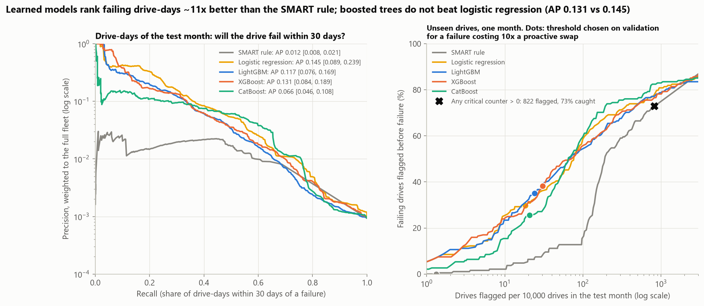
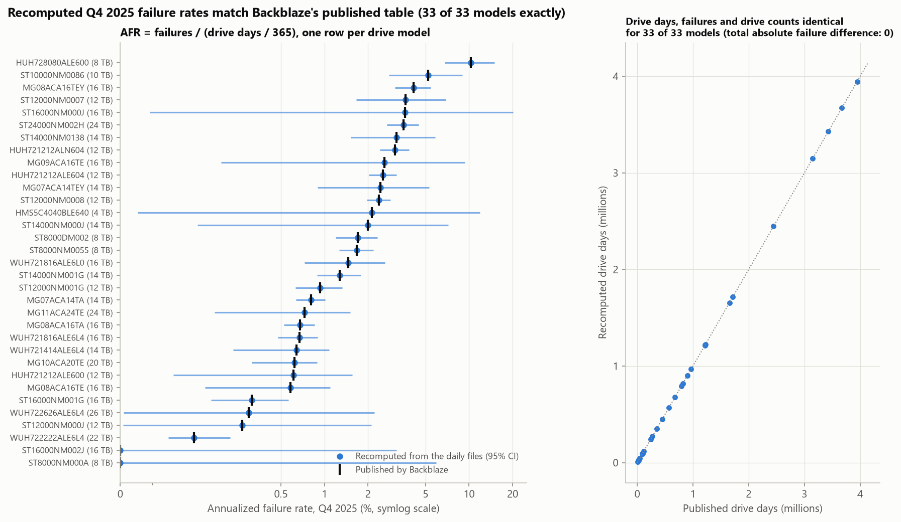
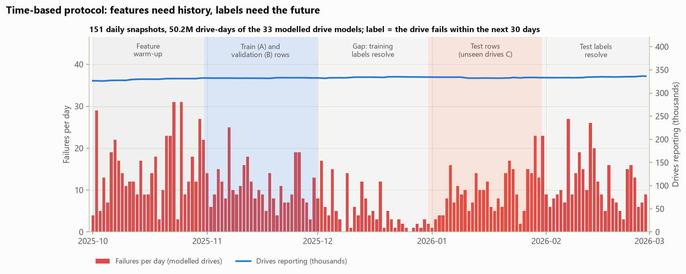
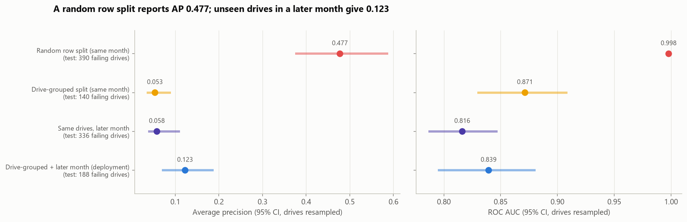
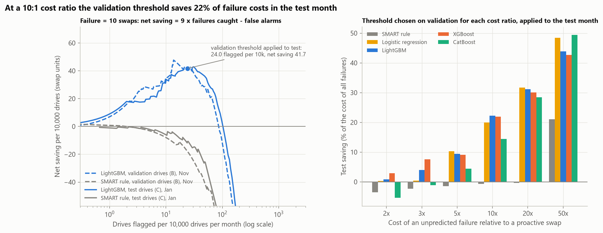
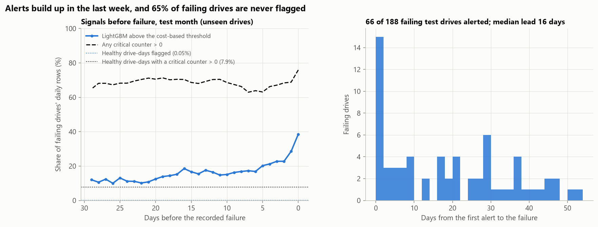
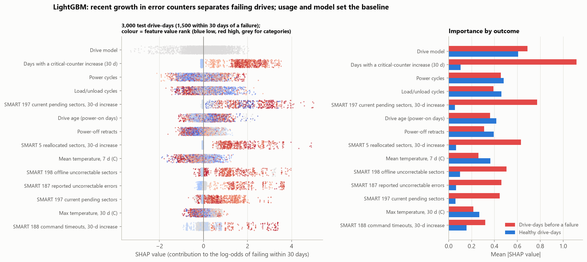
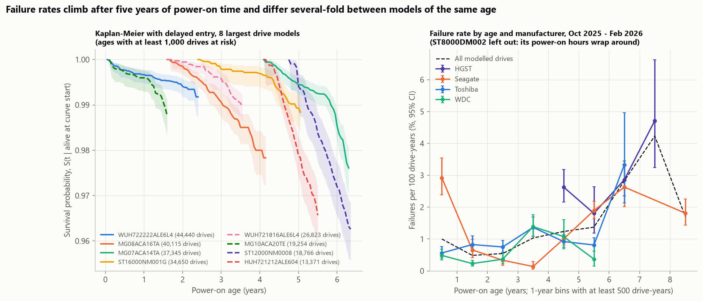

# Predicting Hard-Drive Failures from SMART Telemetry with PySpark

**Can daily SMART telemetry flag a hard drive before it fails, well enough to justify swapping it early?** This
project builds a PySpark pipeline over Backblaze Drive Stats (151 daily snapshots of about 330,000 drives,
1 October 2025 to 28 February 2026, 50.9 million drive-days), predicts whether each drive fails within the next
30 days, and turns the scores into an alert policy with a cost-based threshold. It also measures failure rates by
drive model and age with Kaplan-Meier survival curves.

It mirrors the predictive-maintenance and risk work of a data-platform team: large daily telemetry that needs
distributed ETL, very rare positives (fewer than one drive-day in 1,000 is within 30 days of a failure), a strong
temptation to leak information across time and devices, and a decision that has to be priced (a false alarm costs
a drive swap, a missed failure costs a rebuild). The models are therefore judged on drives they never saw, in a
month that starts after all training labels were known, and the ETL is checked against Backblaze's own published
failure-rate table.



## Key findings

Test set: 467,279 sampled drive-days (representing about 3.1 million) of January 2026 from drives held out of
training and tuning; 188 of these drives fail within the label window. Average precision (AP) and recall are
weighted to the full fleet; 95% CIs resample drives.

| Scorer | AP (95% CI) | ROC AUC | Recall at 1% FPR | Drives flagged per 10k per month* | Failing drives caught* | Precision* | Net saving per 10k drives* |
|---|---:|---:|---:|---:|---:|---:|---:|
| SMART rule: sum of critical counters | 0.012 [0.008, 0.021] | 0.814 | 0.14 | 1.3 | 0% | 0% | -1.3 |
| SMART rule: any critical counter > 0 | | | | 822 | 73% | 1.7% | -686 |
| Logistic regression | **0.145** [0.089, 0.239] | **0.891** | 0.53 | 18.3 | 30% | 31% | 37.5 [23.6, 51.9] |
| LightGBM (Optuna, 25 trials) | 0.117 [0.076, 0.169] | 0.846 | 0.47 | 24.0 | 35% | 27% | **41.7** [27.2, 58.2] |
| XGBoost (Optuna, 15 trials) | 0.131 [0.084, 0.189] | 0.875 | 0.47 | 30.6 | 38% | 23% | 41.1 [24.4, 58.2] |
| CatBoost (Optuna, 8 trials) | 0.066 [0.046, 0.108] | 0.856 | 0.55 | 20.8 | 26% | 23% | 27.0 [13.7, 41.3] |

<sub>*Drive-level alerting at a 10:1 cost ratio (a missed failure costs ten proactive swaps): a drive is flagged if its
daily score crosses a threshold chosen on validation drives at least once in the month. Net saving = 9 x failures
caught - false alarms, in swap units per 10,000 drives per month. Every model and cost ratio is in
[`cost_by_ratio.csv`](reports/results/cost_by_ratio.csv); row-level metrics in
[`model_results.csv`](reports/results/model_results.csv).</sub>

1. **The ETL reproduces Backblaze's published numbers exactly.** For all 33 drive models in Backblaze's Q4 2025
   table, the recomputed drive counts, drive days and failures are identical (30,534,025 drive days, 943 failures,
   AFR 1.13%), and so is every model's AFR. The published "drive count" is reproduced by counting the distinct
   drives seen during the quarter.
2. **A random split of drive-days overstates performance four- to ninefold.** The same LightGBM settings reach
   AP 0.477 and ROC AUC 0.998 when drive-days are split at random, because neighbouring days of the same failing
   drive land on both sides. Holding out whole drives gives AP 0.053 in the same month, and 0.123 on unseen drives
   one month later.
3. **Learned models beat the SMART rule about tenfold, but boosting does not beat logistic regression on the test
   month.** LightGBM led clearly on validation (AP 0.190 vs 0.059), yet on the test month logistic regression
   (0.145) is ahead of XGBoost (0.131) and LightGBM (0.117); neither difference is significant (Holm-adjusted
   p = 0.96). CatBoost, early-stopped after 12 rounds, is significantly worse (0.066, p < 0.001). With 73 failing
   validation drives, model selection on one month is noisy.
4. **A threshold chosen on validation drives transfers to the test month.** At a 10:1 cost ratio LightGBM flags 24
   drives per 10,000 per month, catches 35% of failing drives at 27% precision, and saves 22% of the cost of all
   failures (41.7 swap units per 10,000 drives); the best threshold in hindsight would have saved 43.6. The popular
   rule "any critical SMART counter above zero" catches 73% of failing drives but flags 8% of the fleet (precision
   1.7%) and loses money at every cost ratio up to 50:1.
5. **About a quarter of failures are silent, and many alerts come late.** 51 of the 188 failing test drives (27%)
   never show a critical counter above zero during the month; the models catch 0-16% of those against 35-47% of
   the others. LightGBM's median lead time is 16.5 days, but 15 of its 66 alerts come on the day of the failure or
   the day before.
6. **Failure rates differ up to twentyfold between drive models and rise with age.** Among models with more than
   1,000 drives, the five-month AFR ranges from 0.29% (WUH722222ALE6L4, 44,461 drives) to 6.3% (HUH728080ALE600).
   By power-on age it is 0.5% at 1-3 years, 1.2-1.4% at 4-6 years and 2.8-4.2% at 6-8 years. The one-year failure
   probability read off Kaplan-Meier curves with delayed entry is close to the five-month AFR for the largest
   models (ST12000NM0008: 2.2% vs 2.5%; HUH721212ALE604: 2.8% vs 2.6%; largest gap WUH721816ALE6L4: 1.2% vs 0.7%).

## Results

### Checking the ETL against the published table



Backblaze publishes a quarterly table of drive count, drive days, failures and AFR per drive model; its Q4 2025
table (33 models, 337,192 drives) was transcribed into
[`data/reference/backblaze_q4_2025_quarterly.csv`](data/reference/backblaze_q4_2025_quarterly.csv) and checked by
recomputing its totals and every AFR from the transcribed counts. The Spark aggregation reproduces every number
([`afr_crosscheck_q4_2025.csv`](reports/results/afr_crosscheck_q4_2025.csv)). Mean ages agree within a few months,
except for ST8000DM002: its power-on hours (SMART 9) wrap around at 65,536 hours, so the recomputed mean age is 7.5
months instead of 109.9. That model is left out of the age analyses; its 8,960 drives keep their (wrapped) age
feature in the models, where the drive model is also a feature.

### Labels, splits and the cost of a careless split



A drive-day is positive when the drive's recorded failure falls within the next 30 days (that day included).
Drives are assigned by a hash of the serial number to training (A, 55%), validation (B, 15%) and test (C, 30%)
groups. Models train on November drive-days of group A, using October as feature history, are tuned on November
drive-days of group B, and are tested on January drive-days of group C. The test month starts 30 days after the
training month ends, so every training label was known before the first test day.



| Protocol ([`split_protocols.csv`](reports/results/split_protocols.csv)) | Test failing drives | AP (95% CI) | ROC AUC | Recall at 1% FPR |
|---|---:|---:|---:|---:|
| Random split of drive-days (same month) | 390 | 0.477 [0.375, 0.588] | 0.998 | 0.99 |
| Drive-grouped split (same month) | 140 | 0.053 [0.034, 0.090] | 0.871 | 0.47 |
| Same training drives, later month | 336 | 0.058 [0.038, 0.111] | 0.816 | 0.38 |
| Unseen drives, later month (deployment) | 188 | 0.123 [0.069, 0.188] | 0.839 | 0.46 |

The random split lets the model recognise a failing drive from its other days instead of learning what precedes a
failure. The last three protocols should not be ranked against each other: in group C, January has more
positive drive-days than November (0.09% vs 0.07% of weighted drive-days), which raises AP by itself.

### Models

All models use the same 41 features computed in Spark: raw values and 7- and 30-day increases of nine SMART error
counters (5, 187, 188, 197, 198, 199, 184, 10, 189), the sum of the five critical counters and the number of days in
the last 30 on which it increased, power-on age, power cycles, load/unload cycles and power-off retracts with their
recent increases, temperature (current, 7-day mean, 30-day max), capacity, drive model and manufacturer.

Paired bootstrap differences against logistic regression (400 resamples of drives, Holm-corrected over 16 tests;
[`model_significance.csv`](reports/results/model_significance.csv)):

| Test month | AP difference (95% CI) | Holm p | ROC AUC difference (95% CI) | Holm p |
|---|---:|---:|---:|---:|
| SMART rule (sum) | -0.133 [-0.223, -0.078] | < 0.001 | -0.077 [-0.110, -0.044] | < 0.001 |
| LightGBM | -0.029 [-0.102, +0.020] | 0.96 | -0.045 [-0.072, -0.019] | < 0.001 |
| XGBoost | -0.015 [-0.096, +0.033] | 0.96 | -0.016 [-0.038, +0.005] | 0.96 |
| CatBoost | -0.079 [-0.157, -0.032] | < 0.001 | -0.035 [-0.064, -0.007] | 0.14 |

Validation AP (group B, November; 73 failing drives) ranked the models the other way: LightGBM 0.190
[0.099, 0.281], XGBoost 0.161, CatBoost 0.135, logistic regression 0.059 [0.027, 0.116]. The test AP of logistic
regression lies above its validation CI and LightGBM's near the bottom of its own; with this few failures per month
the validation set cannot reliably separate the models. The net savings of logistic regression, LightGBM and
XGBoost are close at every cost ratio, and their CIs overlap widely.

### Alert threshold and costs



For each cost ratio, the threshold that maximises the net saving on the validation drives is applied to the test
drives. The saving curves of the validation and test months have the same shape, and at 10:1 the chosen
thresholds land within 2-3 swap units of the best threshold in hindsight (LightGBM: 41.7 vs 43.6 per 10,000
drives). At a 2:1 or 3:1 ratio no model saves more than 8% of failure costs; at 50:1 the models save 43-49%. The
critical-counter sum has no useful threshold below 50:1: its top ranks are set by SMART 188, which some Seagate
models report as a large composite number (the validation-optimal threshold is 9.4 x 10^11).

### Lead time and silent failures



On the failing test drives, the share of daily rows above LightGBM's 10:1 threshold rises from about 12% thirty
days before the failure to 39% on the day itself; for healthy drive-days it is 0.05%. Between 63% and 76% of
failing drives' rows show a critical counter above zero, but so do 7.9% of healthy drive-days, which is why the
any-counter rule cannot be used on its own. Of the drives LightGBM catches, 43 of 66 are alerted at least a week
ahead ([`lead_times.csv`](reports/results/lead_times.csv), [`failure_signals.csv`](reports/results/failure_signals.csv)).
Recall differs by manufacturer: at the 10:1 threshold LightGBM catches 49% of failing Seagate drives, 33% of HGST,
30% of Toshiba and 7% of WDC drives.

### What the model uses



TreeSHAP values of the LightGBM model on 3,000 test drive-days (half of them within 30 days of a failure) are taken
from LightGBM's own implementation and match the `shap` library's TreeExplainer exactly on 200 rows. For drive-days
before a failure, the largest contributions come from the number of days with an increase in a critical counter
and the 30-day growth of pending (197) and reallocated (5) sectors. For healthy drive-days, the drive model and
usage (power cycles, load/unload cycles, power-off retracts, age, temperature) set the baseline risk
([`shap_importance.csv`](reports/results/shap_importance.csv)).

### Failure rates by model and age



The Kaplan-Meier curves use delayed entry (left truncation): each drive joins the risk set at the power-on age it
had on its first day in the data, so five months of observation cover ages from 0 to about 9 years. Each curve
covers the longest age range with at least 1,000 drives at risk and is conditional on surviving to its first age
([`km_summary.csv`](reports/results/km_summary.csv), [`km_curves.csv`](reports/results/km_curves.csv)). Failure
rates per drive-year by age ([`afr_by_age.csv`](reports/results/afr_by_age.csv)) are 1.0% in the first year (102
of its 180 failures are Seagate drives, at 2.9% per drive-year), 0.5% at 1-3 years, 1.0-1.4% at 3-6 years and
2.8-4.2% at 6-8 years. Within the same age, manufacturers differ several-fold: at 4-5 years HGST drives fail at 2.6% and Toshiba drives at 0.9%. AFRs with exact
Poisson CIs for every model and period are in [`afr_by_model.csv`](reports/results/afr_by_model.csv).

## Data

| | |
|---|---|
| Source | [Backblaze Drive Stats](https://www.backblaze.com/cloud-storage/resources/hard-drive-test-data): daily SMART snapshots of every drive in Backblaze's data centres, published as quarterly zip archives |
| Coverage | 1 Oct 2025 - 28 Feb 2026: all 92 days of Q4 2025 and the first 59 days of Q1 2026; 50,888,711 drive-days, 1,571 failures (all models) |
| Download | Only the needed daily CSVs are fetched out of `data_Q4_2025.zip` and `data_Q1_2026.zip` with HTTP range requests (2.0 GB compressed of the 2.5 GB archives); each file's CRC-32 is verified and 28 columns are kept as one Parquet file per day in `data/raw/` (git-ignored) |
| Modelled drives | The 33 hard-drive models in Backblaze's Q4 2025 quarterly table (341,441 drives; boot SSDs and small models excluded, as in Backblaze's reports) |
| Published reference | Q4 2025 quarterly failure-rate table from Backblaze's "Backblaze Drive Stats for 2025" blog post (February 2026), transcribed into `data/reference/` |
| Terms | Backblaze makes the data free to use on condition that Backblaze is cited as the source, users take responsibility for their use of it, and the data is not sold. Source: Backblaze Drive Stats, https://www.backblaze.com/cloud-storage/resources/hard-drive-test-data |

Data checks ([`data_quality.csv`](reports/results/data_quality.csv),
[`bronze_daily_checks.csv`](reports/results/bronze_daily_checks.csv)): 151 of 151 days CRC-verified, no duplicate
(serial, date) rows, no missing serial numbers. The weighted drive sample reproduces the exact number of drive-days
in the training and test months within 0.6% ([`sampling_check.csv`](reports/results/sampling_check.csv)).

## Method

**ETL (PySpark 4.2, `local[2]`, 4 GB driver).** The daily Parquet files are read into Spark, model names are
normalised (manufacturer prefixes removed), and three jobs run: daily counts per drive model (for AFR), one record
per drive (first and last report, failure date, power-on hours at entry and exit), and the feature table. The
feature job broadcast-joins the sampled drives, partitions by serial number, orders by day and computes window
features: changes against the report 7 and 30 rows earlier, 7- and 30-day calendar windows (`rangeBetween`) for
temperature and counter increases, and the label. Spark's Parquet writer needs Hadoop's native Windows binaries, so
the feature table is written by pyarrow inside the Spark tasks (`mapInArrow`) and small aggregates are collected
with Arrow. The ETL takes under two minutes for 50.9 million rows on two cores.

**Labels and sampling.** y(d, t) = 1 if drive d's first recorded failure f satisfies t <= f <= t + 29. Rows
whose 30-day window ends after the drive's last report without a failure are censored and dropped (245 and
4,483 sampled rows in the training and test months). Every drive that fails in the label window is kept; other
drives are kept with probability 0.15 and weight 1/0.15. Training uses all positive drive-days of group A and 12% of its negative ones;
every metric uses the weights, so it estimates the full-fleet value.

**Models.** Logistic regression on signed log(1 + |x|) features with median imputation, missing-value indicators
and one-hot drive model (C chosen on validation). LightGBM, XGBoost (hist) and CatBoost with native categorical
handling, each tuned with Optuna's TPE sampler (25, 15 and 8 trials, 150 s cap per family) to maximise weighted AP
on group B; early stopping (50 rounds) uses all positives and 10% of the negatives of group B, because scoring AP
on all 230,000 validation rows every round would dominate the training time. All use 2 threads. Each tuned model
is logged to a local MLflow store (`mlruns/`, git-ignored).

**Metrics.** Weighted average precision AP = sum_k (R_k - R_{k-1}) P_k over distinct thresholds (identical to
scikit-learn's), weighted ROC AUC, and recall at 0.1% and 1% false-positive rate. CIs use a Poisson bootstrap over
drives (all rows of a drive move together), 400 resamples, paired across models; p-values are Holm-corrected.

**Alerting.** For a threshold tau, a drive is flagged if max_t score(d, t) >= tau during the month, and is positive
if it fails in the label window. With a swap cost of 1 and a missed-failure cost of k, net saving =
(k - 1) TP - FP (weighted counts); tau maximises it on group B and is then applied to group C. Drive-level CIs use
1,000 Poisson bootstrap resamples of drives.

**Reliability.** AFR = failures / (drive days / 365) x 100% with exact Poisson (Garwood) CIs. Kaplan-Meier with
delayed entry uses lifelines on power-on years; drives whose power-on hours decrease, exceed 15 years or grow faster
than calendar time are dropped (2,164 drives), as is ST8000DM002.

## Validation and limitations

- **Five months, not a year.** To stay within a 2 GB download, the data cover October 2025 to February 2026. That
  leaves one training month and one test month, with 188 failing test drives and 73 failing validation drives;
  the model ranking changed between the two, and a rolling evaluation over many months would be needed to choose
  between logistic regression and boosting with confidence.
- **Small tuning budgets.** Optuna ran 25, 15 and 8 trials; CatBoost's best trial stopped after 12 rounds and is
  probably under-tuned. No feature selection or class-weight study was done.
- **Label noise.** Backblaze records a failure when a drive is removed for failing; some removals are preventive,
  and drives that leave the fleet without a failure record are treated as censored. 27% of failing test drives
  showed no critical-counter signal at all.
- **Vendor-specific SMART encodings.** Raw values are used as reported: SMART 188 is a composite number on some
  Seagate models, and SMART 9 wraps around on ST8000DM002. Attribute meanings and units differ by manufacturer,
  which the drive-model feature only partly absorbs.
- **Simplified alert model.** Any alert during the month counts as catching a later failure, even when it comes
  30 or more days before the failure (16 of LightGBM's 66 caught drives) or only on the failure day or the day
  before (15 drives). Real costs depend on redundancy, rebuild time and staffing.
- **Kaplan-Meier from five months.** The survival curves stitch together cohorts that reached each age in different
  years (a synthetic cohort), so they assume failure rates at a given age have not changed across vintages.
- **Transcribed reference.** The published table was transcribed from an image in Backblaze's blog post; the
  transcription reproduces the published totals (337,192 drives, 30,534,025 drive days, 943 failures) and every AFR.
- **Local Spark only.** The ETL runs in Spark local mode on two cores; the same code runs on a cluster, but that was
  not tested.

## Reproduce

Requires Python 3.10+ and a Java runtime for Spark (tested with Java 25; Spark 4.2 also supports 17 and 21).

```bash
pip install -r requirements.txt
python scripts/run_pipeline.py            # full run: downloads 2.0 GB once (about 5 minutes), then about 5.5 minutes on 2 CPU threads
python scripts/run_pipeline.py --quick    # smoke test on 20 days with tiny budgets; outputs go to data/cache/smoke/
python scripts/make_figures.py            # redraw figures from reports/results/
pytest                                    # 21 tests, including the Spark ETL on a synthetic fleet
```

The daily Parquet files, the Spark outputs and the model results are cached under keys that include every setting
that changes them (`data/raw/bronze-b1/`, `data/cache/etl-<key>/`, `data/cache/models-<key>/`), so a re-run only
recomputes what changed. On the run reported here, the Spark ETL took 109 s, model tuning and fitting 173 s and the
evaluation 27 s.

## Project structure

```
drivefail/
  download.py       range-request reader for the quarterly zips (central directory, CRC check), daily CSV -> Parquet
  spark_etl.py      Spark session, daily counts, per-drive table, drive sampling, window features and labels, Arrow writer
  features.py       feature definitions and readable names
  reliability.py    AFR with Poisson CIs, published-table check, Kaplan-Meier with delayed entry, AFR by age
  models.py         logistic baseline, Optuna tuning of LightGBM / XGBoost / CatBoost, TreeSHAP
  evaluation.py     weighted AP / ROC AUC, drive-clustered bootstrap, Holm, drive-level alerting, cost thresholds
  tracking.py       MLflow logging
  figures.py        all report figures
  plotting.py       shared colorblind-safe styling
scripts/            run_pipeline.py (every stage), make_figures.py
notebooks/          analysis.ipynb, the walkthrough with every table
data/reference/     Backblaze's published Q4 2025 table (transcribed)
reports/            figures/ and results/ (every number quoted above)
tests/              pytest suite (zip range reading, Spark features and labels, metrics, reliability, models)
```

## License and citation

Code: MIT; see [LICENSE](LICENSE). Data: Backblaze Drive Stats, used under Backblaze's terms (cite Backblaze as the
source; the data may not be sold). The raw data are not redistributed; the committed tables contain only aggregates
and model outputs.

- Backblaze. Hard Drive Data and Stats. https://www.backblaze.com/cloud-storage/resources/hard-drive-test-data
- Backblaze. Backblaze Drive Stats for 2025 (February 2026). https://www.backblaze.com/blog/backblaze-drive-stats-for-2025/
- Methods: Kaplan and Meier (1958); Garwood (1936), exact Poisson intervals; Akiba et al. (2019), Optuna; Ke et al.
  (2017), LightGBM; Chen and Guestrin (2016), XGBoost; Prokhorenkova et al. (2018), CatBoost; Lundberg et al. (2020),
  TreeSHAP; Holm (1979).
